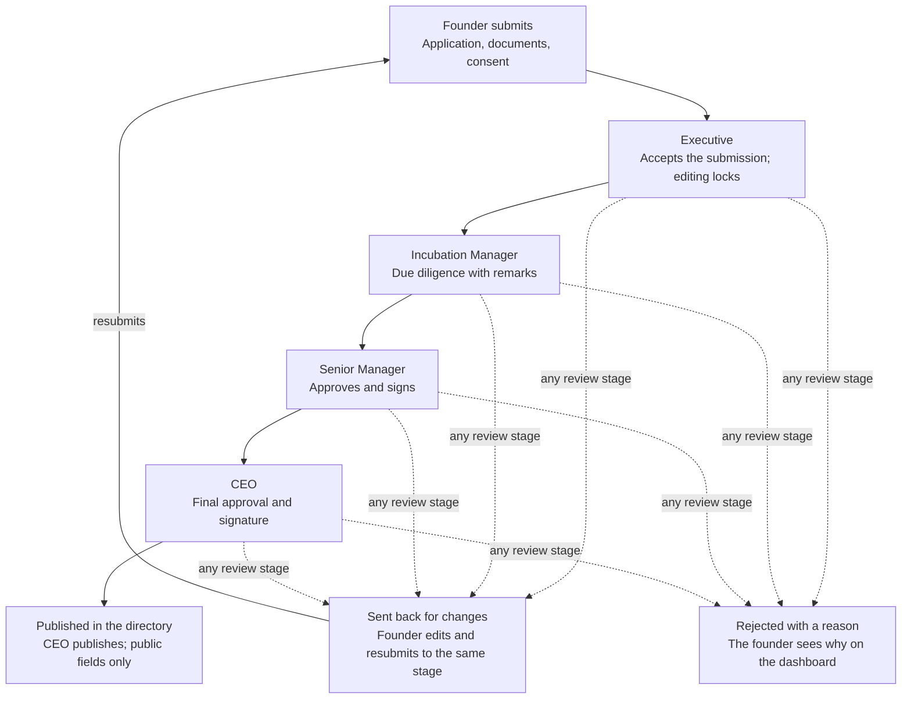

# CIMP-BIIF Portal Demo Walkthrough

21 Nov 2026 · Live version: https://claude.ai/artifact/EuVSFSNoBYnrAqhfozT7yP

The demo runs about 35 minutes in six acts (plus an optional 10-minute Phase 2 preview), each signed in as a different person, so CIMP sees the same startup move through every role. All names and numbers are sample data, tagged "Sample" on screen.

## Before the demo

1. Start PostgreSQL in DBngin and wait about 10 seconds until it accepts connections.
2. In the project folder run `npm run dev` and open http://localhost:3000.
3. For a clean start, run `npm run db:reset` first. It wipes the demo database and reloads the sample data below.
4. Keep the dev-server terminal visible to you. Emails and sign-up codes (OTP) are printed there, because no mail account is connected in the demo.
5. Use one normal browser window and one private window, so two people can be signed in side by side (for example a founder and the Executive).
6. Turn the laptop to 100% zoom and close other tabs.

### Demo accounts

Office passwords are `Demo@1234`. Founder and mentor passwords are `demo123`.

| Who | Login | Starts the demo as |
| --- | --- | --- |
| CEO | ceo@cimp.local | Owner; final approval, fast-track, publishing, team management |
| Admin IT | admin@cimp.local | Form builder, website content, audit log |
| Senior Manager | srm@cimp.local | Approves and signs; routes mentor requests; approves investors |
| Incubation Manager | mgr@cimp.local | Due diligence; approves mentors; reviews connection requests |
| Executive | exec@cimp.local | First check of new applications |
| Office Staff | staff@cimp.local | Corrects application details; messages applicants |
| Founder: GreenGrid Labs | incubatee@demo.com | Approved and published; one mentor connected, two requests open |
| Founder: MediScan | founder2@demo.com | Under review, waiting for the Incubation Manager |
| Founder: KisanLink | founder3@demo.com | Just submitted, waiting for the Executive |
| Mentor: Priya Sinha | mentor1@demo.com | Approved; mentoring GreenGrid, chat under way |
| Mentor and investor: Vikram Rao | mentor2@demo.com | Has an investment request from GreenGrid waiting for an answer |
| Mentor: Meera Jha | mentor3@demo.com | Approved; investor application waiting for the Senior Manager |
| Mentor: Arvind Kumar | mentor4@demo.com | Profile waiting for the Incubation Manager |

Office users can sign in only with a company email (@cimp.local in the demo). Google sign-in is offered only to founders and mentors.

## Act 1: The public website (5 min, no login)

Message: one place where founders, mentors and partners learn about CIMP-BIIF, built on CIMP's own branding.

1. **Home** (`/`). Point out the bodhi tree from the CIMP-BIIF logo, animated with roots and fireflies, and the Montserrat font matching the logo. Scroll to open calls, impact numbers, programs and featured startups.
2. **About** (`/about`). Show the leadership messages with photos of Prof. (Dr.) Rana Singh and Kumod Kumar, the host institute and the four-stage governance.
3. **Programs, How to apply, Schemes, Facilities**. One page each; mention that the text is sample until CIMP sends final content.
4. **Startup directory** (`/startups`). Filter by sector or stage, then open **GreenGrid Labs**. Its public profile shows only the fields CIMP chooses to make public, never phone numbers or documents.
5. **Mentors** (`/mentors`). Open a mentor's public profile. Only approved mentors who opted in appear, and their email is never shown.
6. **FAQ** (`/faq`). Say that Admin IT can edit these questions without a developer; Act 6 shows how.

## Act 2: A founder applies (6 min)

Message: applying takes about 15 minutes, and the founder always knows where the application stands.

1. **Register live** (`/register`). Show the choice between Founder and Mentor / Investor, and the consent box for the Terms and Privacy Policy. Use any new email; the 6-digit code appears in the dev-server terminal. Point out the note that office staff cannot sign up here.
2. **Switch to KisanLink** (founder3@demo.com) to save typing. Open **Apply** (`/apply`): four steps, help text, character limits, a completion meter, and badges marking which answers become public if approved.
3. **Documents** on the same page: upload a PDF as the pitch deck and an image as the logo. Mention that only the founder and the review team can open these files, and that a disguised file (for example a web page renamed .png) is rejected.
4. **Dashboard** (`/dashboard`). The founder sees the current stage, who it is waiting on and for how many days, with an email and a bell notification at every step.
5. **Profile and Settings** (top-right menu). The founder can change their name and password and see when they accepted the Terms.

## Act 3: The four-stage review (8 min)

Message: every decision is made by the right role, in order, with a remark and a signature on record.

At any review stage the reviewer can send the application back for changes or reject it with a reason; only after the CEO's signed approval can it be published.

Take KisanLink through all four stages. Keep the founder signed in, in the private window, so CIMP sees each step land on the founder's dashboard.

1. **Executive** (exec@cimp.local) opens **Applications** (`/approvals`). Open KisanLink's side panel: details, documents, approval trail, activity and chat. Click **Accept Submission** with a remark. The application is now locked for editing.
2. **Incubation Manager** (mgr@cimp.local) clicks **Complete Due Diligence** with a remark.
3. **Senior Manager** (srm@cimp.local) clicks **Approve & Sign**, draws a signature with the mouse or a finger, and types their name.
4. **CEO** (ceo@cimp.local) clicks **Final Approve & Sign** and signs the same way, then **Publish** to list KisanLink in the public directory. Refresh `/startups` to show it.
5. **Send back instead of reject.** As the Incubation Manager, open **MediScan** and choose send back with "Please add the CIN certificate". The founder sees the request, edits and resubmits, and it returns to the same stage.
6. **Office correction.** As Office Staff (staff@cimp.local), open an application, click **Correct fields**, change the city and give a reason. The application is flagged "Edited by office", the founder is notified, and the old and new values go to the audit log.

Points to say aloud:

- Internal remarks are visible only to the office; the founder sees decisions, not reviewers' notes.
- Higher roles can act on lower stages, and the CEO can fast-track an exceptional application in one step.
- A rejection always needs a reason, which the founder sees.

## Act 4: Mentors and investors (7 min)

Message: CIMP controls who joins the network and every introduction to a startup.

1. **Approve a mentor.** As the Incubation Manager, open **Network** (`/network`), tab **Profiles to review**, and approve Arvind Kumar. He now appears on the public mentors page.
2. **Approve an investor.** As the Senior Manager, approve Meera Jha's investor application on the same tab. One person can be both mentor and investor, with a separate approval for each.
3. **Founder asks for a mentor.** As GreenGrid (incubatee@demo.com), open **Find a mentor** (`/connect`). Filter by sector or "Investors only", then request a mentorship connection with Arvind Kumar and write a short message.
4. **Office review.** As the Incubation Manager, open **Network**, tab **Connection requests**, and click **Approve & forward**. As the Senior Manager, click **Route to mentor**.
5. **Mentor accepts.** Sign in as Arvind Kumar (mentor4@demo.com). The **Mentor hub** (`/mentor`) shows the request; click **Accept**. GreenGrid's request now shows "Connected" with a button to message the mentor.
6. **Investor view.** Sign in as Vikram Rao (mentor2@demo.com) to show an investment request from GreenGrid waiting for his answer. Accepting or declining notifies the founder.

Points to say aloud:

- A mentor never sees a request until the office has approved and routed it.
- Founders can ask only after their own application is approved.

## Act 5: Messages and notifications (4 min)

Message: all conversation stays inside the portal, on record, instead of WhatsApp and email chains.

1. **Founder inbox.** As GreenGrid, open **Messages** (`/messages`). One inbox holds the thread with the incubation team and the thread with mentor Priya Sinha, with unread counts. Reply to Priya.
2. **Mentor side.** As Priya Sinha (mentor1@demo.com), the reply is waiting. Point out the line saying the conversation is visible to the CIMP-BIIF office.
3. **Office oversight.** As the Incubation Manager, open the same conversation from **Messages**: read-only. Then open the thread with investor Vikram Rao to show the office messaging mentors directly.
4. **Notifications.** Open the bell for each role. Then show the dev-server terminal: every key decision (application received, stage cleared, sent back, approved, mentor approved, connection routed) also sends an email. In production these go through CIMP's mail account.

Chat messages raise a bell notification, not an email, so inboxes are not flooded.

## Act 6: Control and governance (5 min)

Message: CIMP runs the portal itself, and every change is on record.

1. **Form builder.** As Admin IT (admin@cimp.local), open **Admin** (`/admin`), tab **Form builder**. Add a question to the application form, for example "Women-led startup?" as a single choice, tick **Public**, and click **Publish**. Show the version history. Open `/apply` as KisanLink to show the new question at once. Point out that built-in questions cannot be deleted and that phone numbers can never be made public.
2. **Website content.** Tab **Website content**: change one impact number, save, and refresh the home page. Then turn off **Sample labels** to show the site without the demo banner, and turn it back on.
3. **Audit log.** Sign in as the CEO and open **Admin**, tab **Audit log**. Everything done in this demo is listed: sign-ins, approvals with remarks and signatures, the office correction with old and new values, the form change. Filter by area or person and download the CSV. These records cannot be edited or deleted, not even by the portal itself.
4. **Team.** As the CEO, open **Team** (`/staff`): only the CEO creates office accounts, and only with a company email. The CEO account itself is created from the command line, not the website.

## Act 7: Phase 2 preview (10 min, optional)

Message: after incubation starts, the portal keeps tracking progress, mentoring and investment, and runs the routine work on a schedule. Phase 2 is a separate scope; show it only if time allows.

1. **Dashboards.** Open the dashboard as GreenGrid, the Executive and Admin IT: each shows its own to-do cards (report due, mentor documents, reports to review, proposals to arrange, posts to approve, members without an ID card).
2. **Progress report.** As the Executive, open **Progress** (`/qpr`). GreenGrid's report for the last quarter is waiting: open it, download the PDF, then accept it or send it back with a note. As GreenGrid, the same page shows each quarter's status; Admin IT can change the report's questions in the form builder.
3. **Mentor sessions.** As Priya Sinha (mentor1@demo.com), open the Mentor hub and click **Sessions & documents** for GreenGrid. Show the completed session with both ratings, the upcoming video call, and the open document request. As GreenGrid, upload the requested file.
4. **Investment.** As the Incubation Manager, open **More → Investment proposals** (`/invest`): Vikram Rao proposes ₹25 lakh in GreenGrid. Schedule a pitch, then click **Record investment**. As Vikram (mentor2@demo.com), **Invest** now shows GreenGrid in his portfolio with its latest accepted progress numbers and a button to message the founders.
5. **Reports and exports.** As the Executive, open **More → Reports** (`/reports`): live figures for the pipeline, sectors, mentoring and progress reports. Export applications to Excel with chosen columns. In **Applications**, the side panel's **PDF** gives the signed application with its approval trail.
6. **Broadcast.** As the Executive, open **More → Broadcast** and send a message to approved mentors. Sending the same message again skips everyone who already received it.
7. **Blog.** As Admin IT, open **More → Blog posts**: a post from Office Staff is waiting. Preview and publish it, then open `/blog`.
8. **ID cards and scheduled jobs.** As Admin IT, open **Admin → ID cards**, issue a card to GreenGrid's founder and open its PDF and verify page. Then open **Admin → Scheduled jobs**: the jobs run on their own at the times shown (next run listed), and **Run now** starts one immediately. **Admin → Email** shows how email is sent and sends a test email.
9. **Signed PDF.** Download KisanLink's application PDF from **Applications**: it ends with the drawn signatures of the Senior Manager and the CEO.

## Closing and questions (5 min)

Close on the founder's dashboard for KisanLink: one application, four roles, every step recorded. Then ask CIMP for the open decisions listed below.

### Likely questions

| Question | Answer |
| --- | --- |
| Is this real data? | No. Everything is sample data. Admin IT loads CIMP's real content at final deployment. |
| Can we change the application form ourselves? | Yes. Admin IT adds or edits questions and chooses which answers are public (Act 6). |
| Who can see a founder's documents? | Only the founder and the CIMP-BIIF office. Only the logo appears publicly, and only after approval. |
| How is consent handled? | Every sign-up records acceptance of the Terms and Privacy Policy, with the date shown in the user's settings. |
| Can someone change a decision after the fact? | No. Decisions, remarks and signatures sit in an append-only audit log; corrections create new records. |
| Does it work on a phone? | Yes. All pages adapt to phone width. |
| Which database? | PostgreSQL, proposed in place of MongoDB in the PRD. It needs CIMP's sign-off. |

### Still open

- **Apple sign-in:** needs CIMP's decision and an Apple developer account.
- **Office accounts:** whether Admin IT may also create office users, or only the CEO.
- **Real content and numbers:** stats, programs, mentors and contacts to come from CIMP.
- **Phase 2 (separate scope):** shown as a working demo in Act 7. Before production it needs CIMP's mail account (set in the server settings; Admin → Email confirms it) and a decision on legally valid eSign: today signatures are drawn in the portal and recorded in the audit log, not Aadhaar eSign or DSC.
